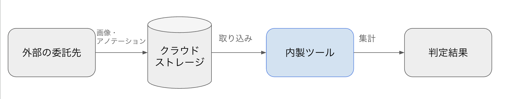
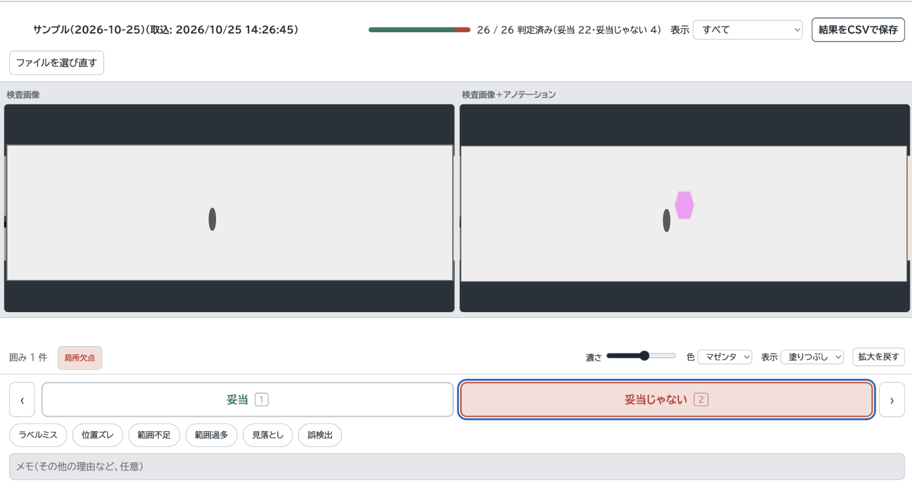

# 「必要最低限」だけを見るアノテーション判定ツールを作った

## はじめに

こんにちは。開発部のしおです。
最近は受託開発に関わらせていただいています。
今回は、受託開発で携わった「アノテーション検収ツール」について、設計で工夫した点などを紹介します。

## 背景

とある印刷関連の製造業のお客様から、印刷物の検品工程に関わるご相談をいただきました。印刷物の欠陥を検出するAIモデルを作るには、まず大量の画像に「ここが欠陥」を示す正解データ（アノテーション）が必要です。このアノテーション作業自体は外部の委託先にお願いしていました。

ここで一つ課題が生まれます。委託先が付けたアノテーションが、本当に正しいとは限らないということです。位置がずれている、範囲が広すぎる・狭すぎる、そもそも見落としている。こうした作業品質のばらつきを、社内の担当者が確認する必要がありました。画像の点数は数百〜数千枚規模にのぼり、とても人力のスプレッドシート運用では回らないため、この確認作業に特化したツールを作ることになりました。

*アノテーション判定の全体の流れ*

## 判定基準の絞り込み

最初に簡単に動かしていた試作では、「良品／不良／要再アノテーション」という3択をそのまま使っていました。ただこれは、アノテーションの正しさと製品の良品・不良品判定という、本来別々の問題を一つの選択肢に混ぜ込んだ形になってしまっています。

たとえば、傷の位置を数ピクセルだけずらして描いてしまったアノテーションがあったとします。アノテーションとしては不正確ですが、その傷自体はごく小さく、出荷基準的には問題にならないかもしれません。逆に、傷の位置が寸分違わず正確に描けていても、その傷が出荷基準を満たすかどうかはまったく別の話です。この2つは、本来別々に考えるべきものでした。

実際にプロジェクトを進める中で、「このツールが見るべきは、委託先のアノテーションが妥当かどうかだけ。製品として出荷してよいかどうかは、別の工程・別のアプリの責務として切り分ける」という方針が示されました。この2つを混同したまま進めると、画面上の選択肢の意味があいまいになり、担当者ごとに判定のブレが出てしまいます。

そこで方針に沿って、判定を「妥当／妥当じゃない」というシンプルな2択に書き換え、チェック対象を明確にしました。「妥当じゃない」を選んだ場合は、ラベルミス・位置ズレ・範囲不足・範囲過多・見落とし・誤検出といった理由をトグルで複数選択できるようにし、後工程（委託先へのフィードバック）に使える粒度の記録を残せるようにしています。

*判定画面のデモ画像*

基準を絞ったことで、それでは表現しきれないケースも見えてきました。1枚の画像に欠陥が複数ある場合です。画像1枚丸ごとで妥当性を判定すると、「1つは正しいけど、もう1つはズレている」というケースを表現できません。そこで欠陥が2件以上ある画像だけ、欠陥ごとに個別で妥当性と理由を選べるようにしました。判定基準そのものは変えず、表現力だけを必要な分だけ足す、という形で解決しています。

## 技術的な工夫

ここからは、実装していて面白いと感じた点をいくつか紹介します。

一つは、バックエンドがまだ無い開発初期の段階から、画面だけ先に作って動かせたことです。画面側のコードは裏側のストレージやデータベースを直接触らず、薄いインターフェースを介してデータをやり取りするだけにしておいたので、最初はローカルのファイル選択で完結するオフライン版で画面を作り込み、後からクラウドにつながるバージョンに同じ画面のまま差し替えることができました。デモ・動作確認用として、オフライン版もそのまま残せています。

次に、サーバーレス環境での署名付きURLの発行です。画像をクラウドストレージに置き、ブラウザに期限付きのURLで配信する仕組みを入れたのですが、ここで一つ壁にぶつかりました。手元のPCではサービスアカウントの秘密鍵を直接使って署名できますが、Cloud Runのようなサーバーレス環境ではその秘密鍵自体が渡されません（セキュリティ上、鍵の実体を環境に置かない設計のため）。そこで、クラウド側が提供している署名専用のAPI（IAM Credentials API）に代わりに署名してもらうよう頼むImpersonation方式に切り替えました。ただしこれを使うには、事前に自分のサービスアカウントへ、自分自身に対する署名権限（Service Account Token Creator）を与えておく必要があります。

最後の一つは、同じ画像を複数人が同時に開いて作業が被ってしまう問題への軽い対策です。本格的な排他ロックを入れると実装も運用も重くなるため、画像を開いた際に「誰が・いつ開いたか」だけを軽く記録しておき、一覧を取得するときに直近数分以内に他の人が開いている画像は一覧の後ろに回す、という仕組みにしました。判定が保存されればその記録は消えますし、ブラウザを閉じて放置された場合も時間が経てば自然に無効になります。非エンジニアの方々が複数人で使う運用を考えると、厳密さより「だいたい被らない」くらいの軽さがちょうどよいと感じた部分です。

## まとめ

今回のツールは、派手な機能こそありません。「何を判定するのか」をきちんと絞り込むこと、非エンジニアの方でも迷わず使える画面にすること、クラウド環境特有の細かい制約を一つずつ潰していくことなどの、地道な意思決定のもと作られています。

受託開発の現場では、こうした「現場の運用に合わせて設計を調整していくプロセス」自体が面白さだと感じています。この記事が、同じような設計判断に向き合う方の参考になれば嬉しいです。
